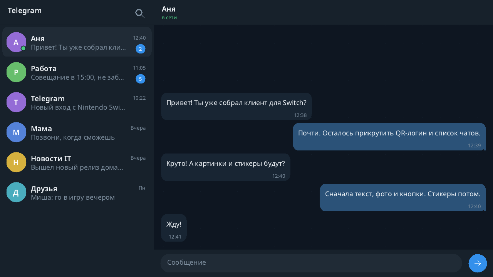
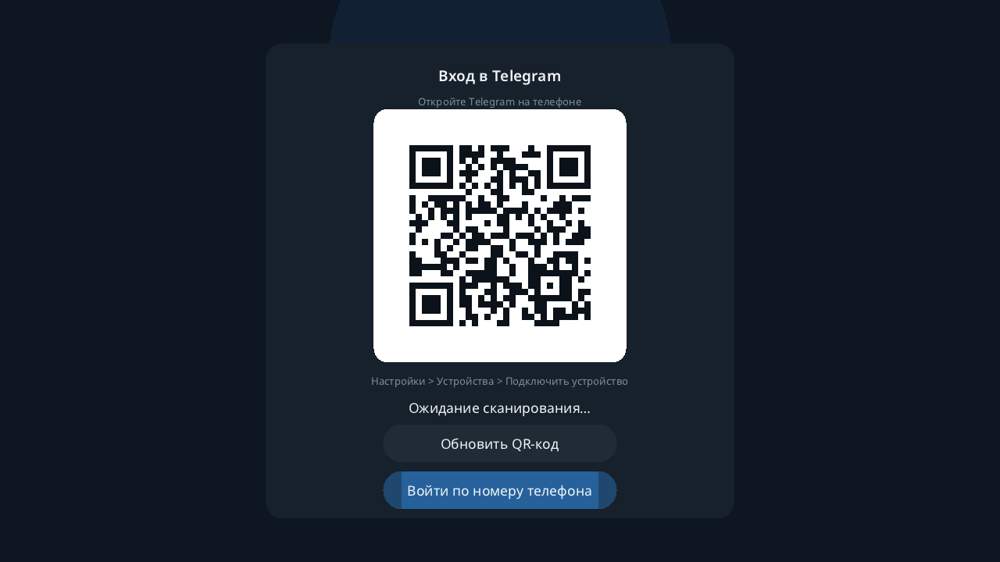

# TelegramNX

Telegram-клиент для Nintendo Switch (homebrew, CFW). Собственный MTProto-стек:
рукопожатие, MTProto 2.0, QR-вход, чаты, история, отправка сообщений, интерфейс
под геймпад и тачскрин.




## Что уже работает

- MTProto 2.0 с реальными DC Telegram: DH-рукопожатие, AES-IGA/CTR, RSA_PAD,
  обфусцированный транспорт (obfuscated2), сжатые ответы, обработка контейнеров.
- QR-вход (`auth.exportLoginToken` / `importLoginToken`), в том числе миграция
  на домашний DC; сессия сохраняется между запусками.
- Двухфакторный облачный пароль: SRP-6a (SHA-256 + PBKDF2-HMAC-SHA512),
  `account.getPassword` / `auth.checkPassword`.
- Загрузка списка чатов, истории сообщений и отправка текста
  (`messages.getDialogs`, `messages.getHistory`, `messages.sendMessage`).
- UI: два-панельный список чатов, пузыри сообщений, экран входа с QR, настройки.
- Сборка под macOS (скриншоты/тесты) и Makefile под Switch (devkitPro + libnx).

## Ограничения

- Вход только по QR-коду; вход по номеру телефона и SMS-коду не реализован.
- Нет медиа (фото/видео/стикеры), редактирования, реакций и push-обновлений:
  список и история обновляются по запросу.
- Нужны собственные `api_id`/`api_hash` с https://my.telegram.org — встраивать
  чужие нельзя.
- `.nro` в этой среде не собран: devkitPro для macOS требует Rosetta/установки
  пакетов, которых здесь нет. Хост-сборка и сетевые тесты проверены; Switch-
  Makefile и платформенный код написаны, но требуют проверки на машине с
  devkitPro.

## Сборка для Switch

1. Установите devkitPro: https://devkitpro.org/wiki/Getting_Started
   (macOS: установщик `devkitpro-pacman-installer.pkg`, затем
   `sudo dkp-pacman -S switch-dev switch-zlib`).
2. Экспортируйте окружение:
   ```sh
   export DEVKITPRO=/opt/devkitpro
   export DEVKITA64=$DEVKITPRO/devkitA64
   export PATH=$DEVKITPRO/tools/bin:$DEVKITA64/bin:$PATH
   ```
3. Соберите:
   ```sh
   make
   ```
   Результат: `build_switch/telegramnx.nro`.
   Готовый workflow для GitHub Actions лежит в
   `.github/workflows/build-switch.yml` (собирает `.nro` в контейнере
   devkitPro).
4. Скопируйте на SD-карту:
   ```
   /switch/telegramnx.nro
   /switch/telegramnx/fonts/NotoSans-Regular.ttf
   /switch/telegramnx/fonts/NotoSans-SemiBold.ttf
   ```
   Шрифты лежат в `assets/fonts/`.
5. Запустите через hbmenu. При первом запуске введите `api_id` и `api_hash`
   (виртуальная клавиатура), затем отсканируйте QR в Telegram:
   Настройки → Устройства → Подключить устройство.

Конфиг и сессия: `sdmc:/switch/telegramnx/config.ini` (содержит auth key —
не делитесь файлом).

## Сборка и проверка на macOS

```sh
cmake -S . -B build
cmake --build build -j8
ctest --test-dir build --output-on-failure   # крипто-тесты
./build/live_auth                             # живое DH + ping к DC2
./build/live_config                           # RPC + gzip (help.getConfig)
./build/ui_shots                              # скриншоты экранов
```

`live_auth` и `live_config` ходят в реальный Telegram; `live_qr` требует
`--api=... --hash=...`.

## Структура

```
src/core/    TL, криптография, DH, MTProto, RPC, API, клиентский поток
src/ui/      канвас, шрифты, экраны
src/platform/  macOS-хост и Switch (libnx)
third_party/ stb_truetype, qrcodegen
tools/       генератор TL-таблиц и референсы протокола
```

## Лицензия

Код — MIT. Шрифты Noto Sans — OFL 1.1. `stb_truetype` — public domain/MIT,
`qrcodegen` — MIT.
